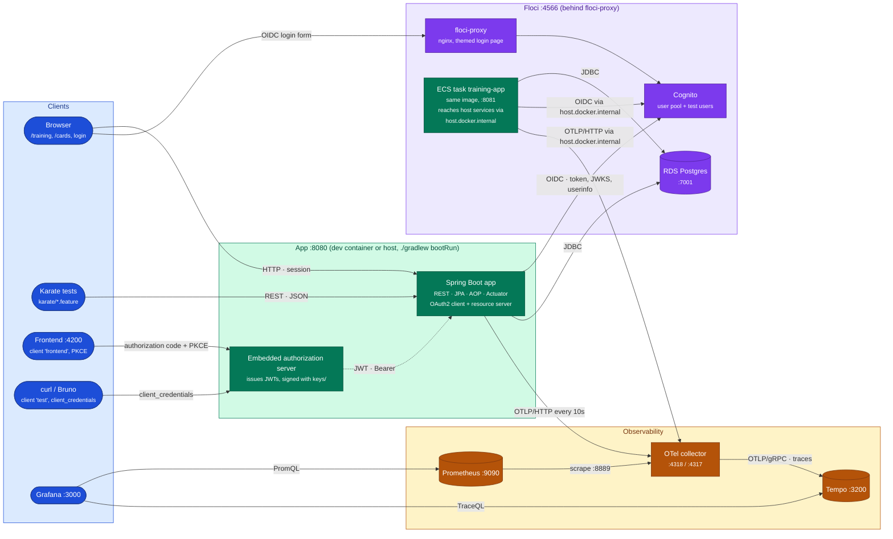

# Architecture

How the training app and its local environment fit together. For the setup steps, see [SETUP.md](SETUP.md).

**Contents:** [Tech stack](#tech-stack) · [Overview](#overview) · [Endpoints and ports](#endpoints-and-ports) · [Profiles and configuration](#profiles-and-configuration) · [Security and authentication](#security-and-authentication) · [Observability](#observability) · [Testing](#testing) · [Where to find each exam topic](#where-to-find-each-exam-topic)

## Tech stack

| Area | Technology |
|---|---|
| App | Spring Boot 4.1.2, Java 21 (Gradle toolchain), Gradle 9.8.2 via wrapper (`./gradlew`) |
| Database | Postgres 16 via Floci RDS; H2 (in-memory) for tests |
| Security | Spring Security OAuth2 client, resource server, authorization server; Cognito via Floci |
| Observability | OpenTelemetry Spring Boot starter (instrumentation BOM 2.33.1), OTel collector, Prometheus, Tempo, Grafana |
| Infrastructure | Docker Compose (Floci + observability stack), Pulumi (TypeScript) for RDS, Cognito and ECS |
| Tooling | mise (tool versions, `boot:*` tasks), Karate (API and load tests), [dev container](.devcontainer/README.md) |

## Overview



- **Host:** Docker Compose runs Floci (behind the nginx `floci-proxy`) and the observability stack. Pulumi provisions RDS Postgres, the Cognito user pool and the ECS service on Floci.
- **App on :8080:** usually runs in the [dev container](.devcontainer/README.md). It connects to `localhost:4566`, `:7001` and `:4318` like an app on the host would; a gost relay in the container forwards these ports to `host.docker.internal`. So the same properties files work in both places.
- **ECS task on :8081:** runs the same image (`<group>/training-app:<version>` from [gradle.properties](gradle.properties), e.g. `eu-meiyu/training-app:0.1.0`) as a container started by Floci. It reaches Postgres, Cognito and the OTel collector on the host through `host.docker.internal`.

## Endpoints and ports

### App entry points

The app runs on **:8080** (dev container or host), the ECS app on **:8081**. `/` is not mapped: application paths not listed here are denied (`anyRequest().denyAll()`). Spring Security's login/callback/error endpoints remain accessible.

| Path | Access | What |
|---|---|---|
| `/training` | public | Study cards page ([static/Spring 2V0-72.22 Study Cards.html](src/main/resources/static/Spring%202V0-72.22%20Study%20Cards.html)) |
| `/about` | public | Build version and build time for the version badge |
| `/cards`, `/cards/categories`, `/cards/kinds` | public | Study cards API (filter with `kind_ids`, ...) |
| `/departments`, `/departments/{id}` | public | CRUD playground (GET, POST, PUT, DELETE; CSRF checks skipped for `/departments/**` and Bearer-token requests) |
| `/samples` | public | Configuration property injection demo |
| `/actuator`, `/actuator/health` | public | All actuator endpoints are exposed |
| `/secured-endpoint/user-info` | `ROLE_USER` | Triggers the Cognito login; shows the logged-in principal |
| `/oauth2/token`, `/oauth2/authorize`, `/.well-known/openid-configuration` | | Embedded authorization server |
| `/logout` | | Logs out locally and at the IdP (Cognito) |

`/about` reads Spring Boot's generated `META-INF/build-info.properties`. Gradle refreshes that file on each build, including `bootBuildImage`.

### Ports

| Port | Service | URL / notes |
|---|---|---|
| 8080 | App (`bootRun`, dev container or host) | http://localhost:8080 |
| 8081 | App as ECS task on Floci | http://localhost:8081 |
| 9010 | JMX or debug port of the app | see the [mise tasks](.devcontainer/README.md#mise-tasks) |
| 4566 | Floci (behind the nginx `floci-proxy` that restyles the Cognito login page) | http://localhost:4566 |
| 7001 | Postgres (Floci RDS) | Floci assigns ports in 7001-7099, check `pulumi stack output dbPort` |
| 4318 / 4317 | OTel collector, OTLP HTTP / gRPC | the app uses 4318 |
| 8889 | OTel collector Prometheus exporter | scraped by Prometheus |
| 9090 | Prometheus | http://localhost:9090 |
| 3200 | Tempo | queried through Grafana |
| 3000 | Grafana | http://localhost:3000 (anonymous access with Admin role, no login) |

## Profiles and configuration

[application.properties](src/main/resources/application.properties) activates the profile group `prod` (`spring.profiles.active=prod`), which expands to six profiles, each with its own file:

| Profile | File | Contents |
|---|---|---|
| `config` | [application-config.properties](src/main/resources/application-config.properties) | `app.config.someValue` (bound by `AppConfigProperties`, shown at `/samples`) |
| `monitoring` | [application-monitoring.properties](src/main/resources/application-monitoring.properties) | Actuator exposure, health status order and HTTP mapping, JMX |
| `logging` | [application-logging.properties](src/main/resources/application-logging.properties) | Log file `logs/app.log`, rolling policy, levels |
| `jpa` | [application-jpa.properties](src/main/resources/application-jpa.properties) | Postgres datasource, `ddl-auto=update`, `data.sql` init |
| `security` | [application-security.properties](src/main/resources/application-security.properties) | Cognito client, authorization server clients, signing keys, IdP logout |
| `otel` | [application-otel.properties](src/main/resources/application-otel.properties) | OTLP endpoint, export interval, Micrometer bridge |

Run a subset by overriding the active profiles, e.g. without the `otel` file:

```bash
./gradlew bootRun --args='--spring.profiles.active=config,monitoring,logging,jpa,security'
```

Keep `security`: the signing key properties live there and the app does not start without them. Leaving out `otel` only drops its settings; the OTel starter then uses its defaults.

The Floci-specific values (Cognito IDs, Postgres port) change with every fresh `pulumi up`, see [Connecting the app to Floci](SETUP.md#connecting-the-app-to-floci).

**ECS overrides:** the ECS task gets [iac/floci-application-properties.json](iac/floci-application-properties.json) as `SPRING_APPLICATION_JSON`. [iac/index.ts](iac/index.ts) fills its `${name}` placeholders from the stack (DB port, Cognito IDs, `host.docker.internal`, ...), so these values override the properties files. It also mounts the host's `keys/` folder into the container at `/workspace/keys`.

## Security and authentication

The app plays three OAuth2 roles (see [config/security](src/main/java/eu/meiyu/training/config/security) and [security](src/main/java/eu/meiyu/training/security)).

**1. OAuth2 client (browser login via Cognito).** Client registration `sso` with provider `cognito`. Opening a protected page redirects to the Floci Cognito login; Cognito calls back to `/login/oauth2/code/sso`. `/logout` also ends the Cognito session (`IdpLogoutSuccessHandler`).

**2. Embedded authorization server.** Issuer `http://localhost:8080` (ECS: `http://localhost:8081`). Users log in through Cognito (federated), and the server issues its own JWTs signed with the keys from `keys/`.

| Client | Type | Grant | Details |
|---|---|---|---|
| `frontend` | public, PKCE required | authorization_code, refresh_token | Redirects `http://localhost:4200/callback`, `http://localhost:8080/oauth2/callback`; scopes `openid profile email` |
| `test` | secret `test` | client_credentials | Scope `api.read` |

**3. Resource server.** Accepts Bearer JWTs from the embedded authorization server. The `groups` claim is mapped to roles.

**Roles from Cognito groups.** Groups in [iac/users.json](iac/users.json) become roles: `user` → `ROLE_USER`, `admin` → `ROLE_ADMIN`, `superadmin` → `ROLE_SUPERADMIN`. `/secured-endpoint/user-info` requires `ROLE_USER`:

| User | Password | Groups | `/secured-endpoint/user-info` |
|---|---|---|---|
| `stefan.theusner` | `Password123!` | user, admin | 200 |
| `jane.doe` | `Password123!` | user | 200 |
| `admin.user` | `Admin123!` | admin, superadmin | **403**: not in `user` (a good exercise in method security) |

**Try the client credentials flow:**

```bash
TOKEN=$(curl -s -u test:test -d grant_type=client_credentials -d scope=api.read \
  http://localhost:8080/oauth2/token | jq -r .access_token)
curl -i -H "Authorization: Bearer $TOKEN" http://localhost:8080/secured-endpoint/user-info
```

The token is accepted, but the call returns 403: a client token has no `groups`, so it has no `ROLE_USER`.

**Why the ECS config looks different:** Floci always reports the Cognito issuer as `http://localhost:4566`, which the ECS container cannot reach. So instead of `issuer-uri` discovery, the ECS config defines a provider `floci-cognito` with explicit endpoints. The browser opens the authorize URL on `localhost:4566`, and the container calls token, JWKS and userinfo via `host.docker.internal:4566`.

**Two apps, one browser:** cookies ignore ports, so the ECS app uses its own session cookie `JSESSIONID_ECS`. If sessions still get mixed up, clear the cookies for `localhost`.

## Observability

| What | How |
|---|---|
| Export | The OTel starter sends metrics and traces via OTLP/HTTP to `localhost:4318`, metrics every 10 s ([application-otel.properties](src/main/resources/application-otel.properties)) |
| Custom metrics | `@TrackMetric` methods are measured by `TrackMetricAspect` with Micrometer and bridged to OTel |
| Metrics | The collector exposes them on `:8889` and Prometheus scrapes them |
| Dashboards | Grafana → Dashboards: **Custom TrackMetrics** (`custom-metrics.json`) and **HTTP Metrics OpenTelemetry** (`http-metrics-otel.json`) in [observability/grafana/dashboards](observability/grafana/dashboards) |
| Traces | Grafana → Explore → data source **Tempo** |
| Logs | Not exported (`otel.logs.exporter=none`). Read `logs/app.log`, e.g. `lnav logs/` |
| Health | `/actuator/health` includes the custom `servicePerformance` indicator (`PerformanceHealthIndicator`). If the average service time exceeds 500 ms it reports `BAD_PERFORMANCE`, which is mapped to HTTP 200 |

## Testing

**Unit and MockMvc tests** need no Floci, Docker or keys:

```bash
./gradlew test
```

Tests boot `WithoutOAuth2Application`, which excludes the OAuth2 auto-configuration and the security config. [src/test/resources/application.properties](src/test/resources/application.properties) replaces the main one, so the `prod` profile group is not active. An embedded H2 datasource is auto-configured from the runtime dependency, so no Floci/Postgres is needed.

**Karate API tests** run against a running app. `base_url` in [karate/env.yaml](karate/env.yaml) is `http://localhost:8080` (change it to `http://localhost:8081` for the ECS app).

```bash
cd karate
karate run departments.feature
karate run cards.feature
```

`departments-create.feature` is tagged `@ignore`: it is called by the load test, not run directly.

**Load test.** Adjust `duration`, `wait_time_ms`, `num_workers` and `target_feature` in [karate/env.yaml](karate/env.yaml); `-T` sets the number of parallel threads:

```bash
cd karate
karate run -T 5 -t @load departments-create-load-test.feature
```

Watch the result in the Grafana dashboards. Reports are written to `karate/target/`.

## Where to find each exam topic

| Topic | Where |
|---|---|
| Container, beans, configuration | [config/AppConfigProperties](src/main/java/eu/meiyu/training/config/AppConfigProperties.java), [feature/sample/](src/main/java/eu/meiyu/training/feature/sample) (`SampleBean`, `SamplePostProcessor`, `SampleController` for `/samples`) |
| AOP | [aop/](src/main/java/eu/meiyu/training/aop): `PointCuts`, `LoggingAspect`, `TimingAspect`, `TrackMetricAspect` |
| Data JPA | [feature/card/repository/](src/main/java/eu/meiyu/training/feature/card/repository), [feature/department/repository/](src/main/java/eu/meiyu/training/feature/department/repository) (incl. `DepartmentSpecifications`), entities in `feature/*/entity` |
| Web and REST | [feature/card/](src/main/java/eu/meiyu/training/feature/card) (`CardController`, `StudyCardsPageController`), [feature/department/](src/main/java/eu/meiyu/training/feature/department) (`DepartmentController`), [controller/](src/main/java/eu/meiyu/training/controller) (`OAuth2Controller`) |
| Security | [config/security/](src/main/java/eu/meiyu/training/config/security), [security/](src/main/java/eu/meiyu/training/security) |
| Actuator | [actuator/](src/main/java/eu/meiyu/training/actuator) (`PerformanceHealthIndicator`), custom metrics via `@TrackMetric` |
| Testing | [src/test](src/test/java/eu/meiyu/training) |

Study cards are seeded from [data.sql](src/main/resources/data.sql) on every start (Postgres `ON CONFLICT`, schema via `ddl-auto=update`). `/training` serves [static/Spring 2V0-72.22 Study Cards.html](src/main/resources/static/Spring%202V0-72.22%20Study%20Cards.html).
