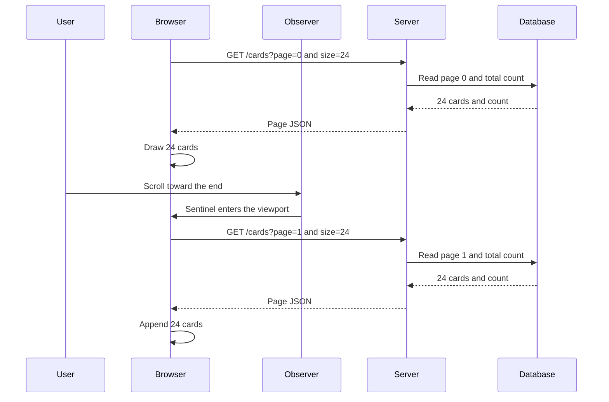
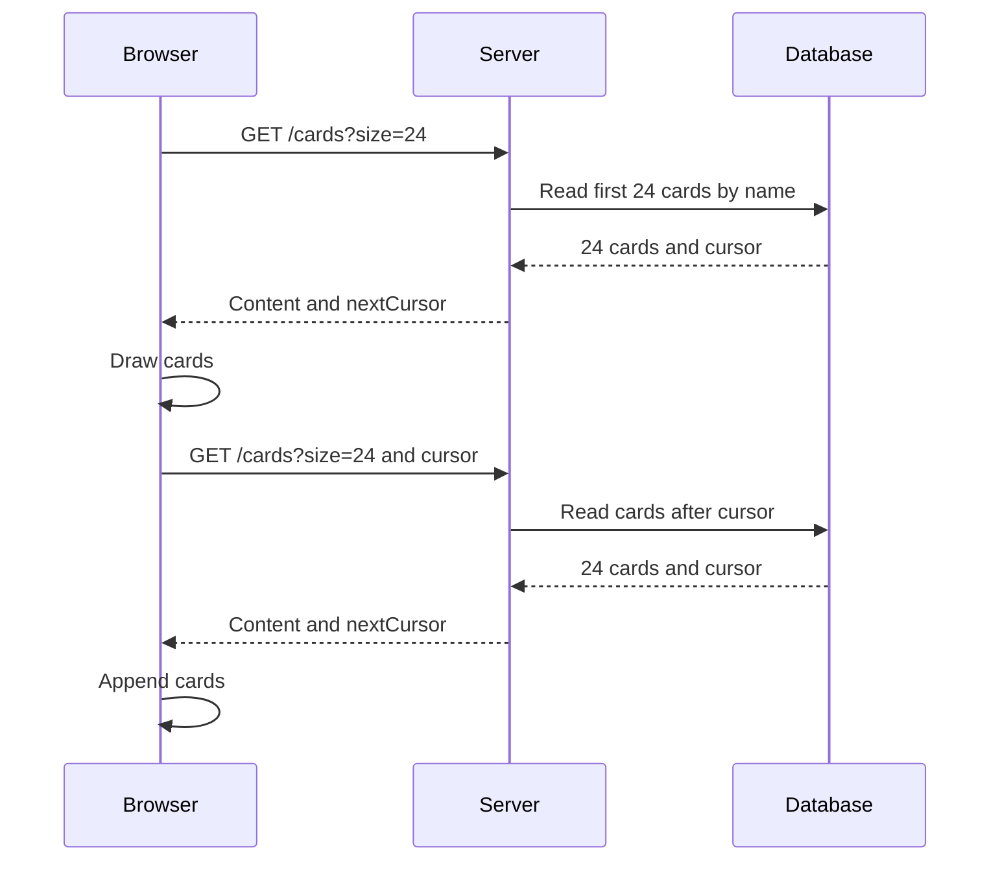
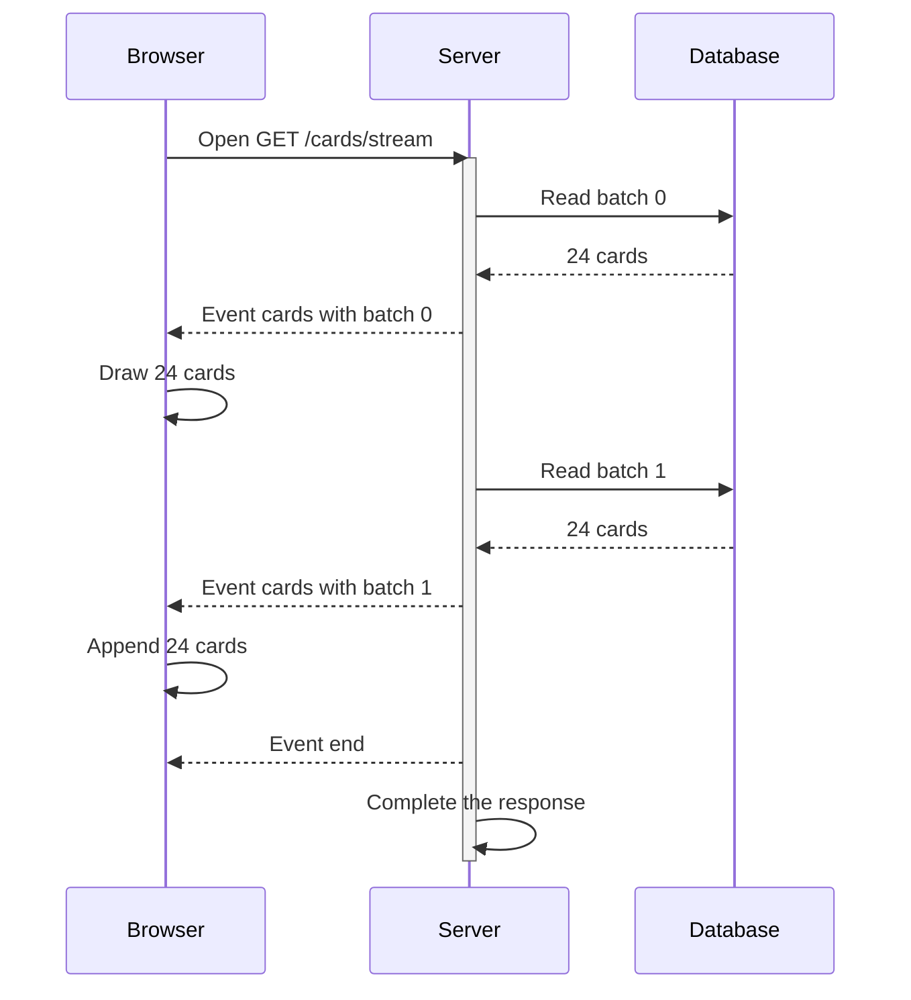
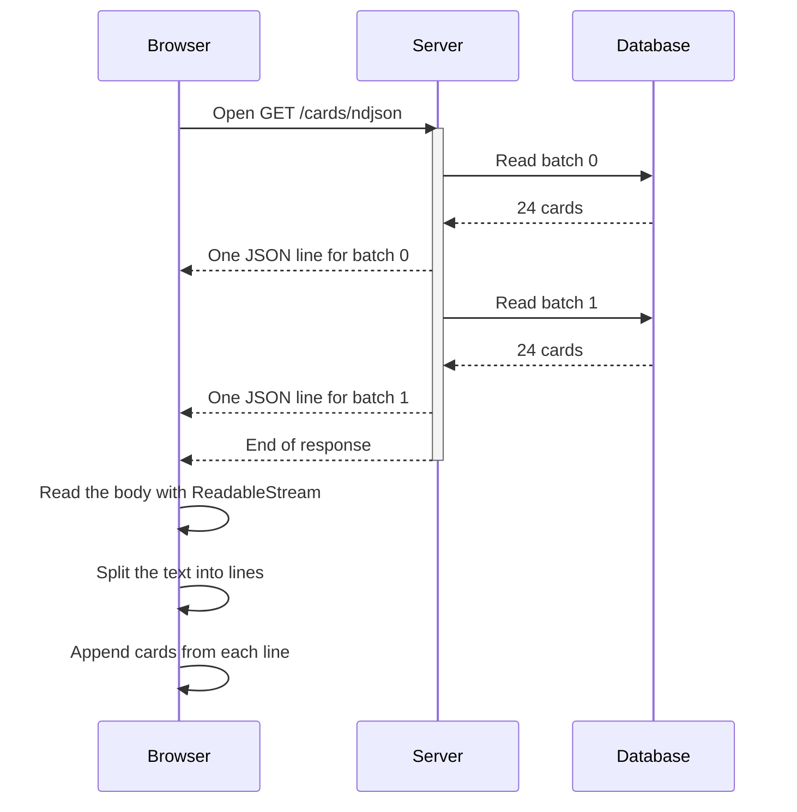
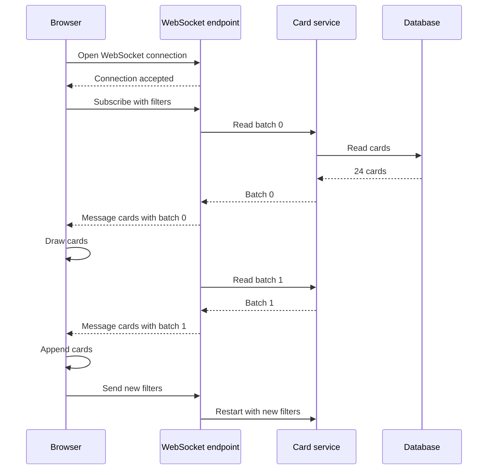
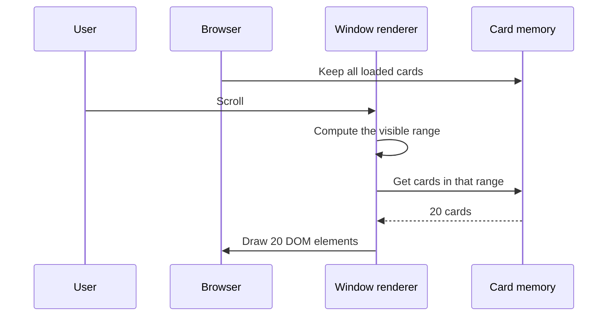

# Card loading options

## Style note

This document follows [Technical writing style](writing-style.md).

## Terms

- **Browser**: The program that shows the study cards page.
- **Server**: The Spring program that sends card data.
- **HTTP**: The protocol that the browser uses to ask the server for data.
- **Page**: A fixed set of cards. The browser asks for each page.
- **Batch**: A fixed set of cards. The server sends each batch on a stream.
- **Stream**: One HTTP connection that stays open while data is sent.
- **Cursor**: A value that marks the last card that the browser got.
- **Observer**: A browser object. It reports when an element enters the viewport.
- **Viewport**: The visible part of the browser window.
- **DOM**: The tree of elements that the browser draws.

---

## 1. Current solution: offset pages with early prefetch

### Explanation

The browser asks for page 0. The server reads 24 cards. The server also reads the total count. The browser draws the cards.

An observer watches a sentinel element. The sentinel is 1200 pixels above the end of the list. When the sentinel enters the viewport, the browser asks for the next page. This happens before the user reaches the last card.

A filter change clears the loaded pages. The browser discards an old response. The browser then draws only the new cards.

### Benefits

- The browser makes one small request at a time.
- The first cards can appear after one database read.
- Standard HTTP tools can cache and test each request.
- The server holds no open connection.

### Limits

- Each page needs one request.
- The server reads the total count for each page.
- If cards are added, page numbers can shift.

---

## 2. Alternative: cursor pages

### Explanation

The server sorts all cards by name. The server returns 24 cards and a cursor. The cursor is the name of the last card.

The browser sends the cursor with the next request. The server reads the cards after that name. The server does not use a page number.

### Benefits

- New cards do not shift later pages.
- The server does not skip rows.
- The browser can stop at any cursor.

### Limits

- The total count needs a separate request.
- The cursor must match the sort order.
- The code is more complex than page numbers.

---

## 3. Alternative: server-sent events

### Explanation

The browser opens one HTTP connection. The server reads one batch at a time. The server sends each batch as a named event. The browser draws each batch when it arrives.

The browser does not ask for batch 1. The server sends it. The browser closes the connection after the end event.

### Benefits

- One connection carries all batches.
- The first cards can appear after one database read.
- The browser has built-in reconnect support.
- Named events are easy to read in logs.

### Limits

- The connection stays open until the stream ends.
- A proxy may buffer the data. The proxy must not buffer this stream.
- The browser cannot set custom headers with `EventSource`.
- A filter change must close the old stream.

---

## 4. Alternative: newline-delimited JSON

### Explanation

The server writes one JSON object on each line. The browser reads the body while the server writes it. The browser splits the text at each new line.

This method uses plain HTTP. It does not use named events. It does not have built-in reconnect support.

### Benefits

- The server code is simple in Spring MVC.
- The browser can start to draw cards at once.
- Custom headers can be used with `fetch`.

### Limits

- The browser must split the lines.
- A broken line can stop the reader.
- Reconnect logic must be written by hand.

---

## 5. Alternative: WebSocket

### Explanation

The browser opens a WebSocket connection. The browser sends a subscribe message with the filters. The server sends card messages on the same connection.

The browser can also send data. This is the main benefit of WebSocket. The server can change the stream without a new HTTP request.

### Benefits

- The connection is two-way.
- Filters can change without a new HTTP request.
- The server can push updates at any time.

### Limits

- The handshake is more complex than HTTP.
- Some proxies need extra settings.
- Sticky sessions may be needed.
- The security rules need a separate configuration.

---

## 6. Alternative: windowed rendering

### Explanation

The browser keeps loaded cards in memory. The browser draws only the cards in the visible range. When the user scrolls, the browser removes old elements. The browser then draws new elements.

This method does not change the server. It can be used with pages, cursors, or streams.

This app uses this method in the overview grid. The spacer keeps the document height. Only the rows near the viewport stay in the DOM.

### Benefits

- The DOM stays small.
- Scroll speed can stay high with many cards.
- The server code does not change.

### Limits

- The card height must be known or measured.
- Scroll position can jump if heights are wrong.
- Search and filters need careful state handling.

---

## Comparison

| Method | First cards | Requests | Server holds a connection | Data changes | Client work | Best use |
|---|---|---|---|---|---|---|
| Offset pages with prefetch | After one page read | One per page | No | Pages can shift | Low | Small and stable data sets |
| Cursor pages | After one page read | One per page | No | Pages stay stable | Low | Large data sets with inserts |
| Server-sent events | After one batch read | One for all batches | Yes | Batch order stays stable | Low | One-way progressive loading |
| Newline-delimited JSON | After one batch read | One for all batches | Yes | Batch order stays stable | Medium | Simple custom streaming |
| WebSocket | After one batch read | One for all messages | Yes | Stream can restart | High | Two-way communication |
| Windowed rendering | Depends on data source | Depends on data source | Depends on data source | No effect | High | Large DOM with many cards |

## Recommendation

The current solution shall remain the default for this app. The app has 197 cards. The first page arrives fast. Prefetch hides later requests.

Cursor pages shall be used if cards are added often.

Server-sent events shall be the first stream choice if the data grows.

WebSocket shall be used only when the browser must send data on the same connection.

Windowed rendering shall be used when the number of DOM elements makes scrolling slow.
